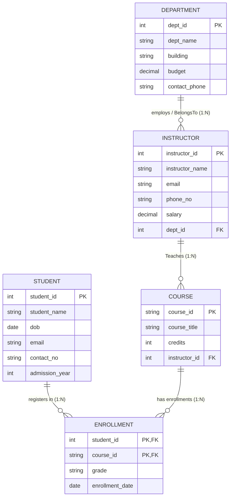

# Problem Statement 04: University Management System

## Problem Description
A university wants to manage information about its students, courses, instructors, and departments. Each student can enroll in multiple courses, and each course can have many students. Each course is taught by an instructor. Each instructor belongs to a single department, but a department can have multiple instructors. For each enrollment, the university wants to record the grade obtained by the student.

---

## Task 1: Identify Entities, Attributes, and Keys

### 1. Entity Sets

| Entity | Type | Description | Primary Key (PK) | Other Attributes |
|---|---|---|---|---|
| **Department** | Strong Entity | Academic departments offering degree programs and employing instructors | `dept_id` | `dept_name`, `building`, `budget`, `contact_phone` |
| **Instructor** | Strong Entity | Faculty members teaching academic courses | `instructor_id` | `instructor_name`, `email`, `phone_no`, `salary`, `dept_id` (FK) |
| **Course** | Strong Entity | Academic subjects/modules offered by the university | `course_id` | `course_title`, `credits`, `instructor_id` (FK) |
| **Student** | Strong Entity | Individuals studying at the university and enrolling in courses | `student_id` | `student_name`, `dob`, `email`, `contact_no`, `admission_year` |

### 2. Attribute Classification

- **Department**:
  - `dept_id`: Simple, single-valued, Key attribute (Primary Key).
  - `dept_name`: Simple, single-valued attribute (e.g., Computer Engineering, Mathematics, Physics).
  - `building`: Simple, single-valued attribute (campus building location).
  - `budget`: Simple, single-valued numeric attribute.
  - `contact_phone`: Simple, single-valued attribute.

- **Instructor**:
  - `instructor_id`: Simple, single-valued, Key attribute (Primary Key).
  - `instructor_name`: Simple, single-valued attribute.
  - `email`: Simple, single-valued, Unique attribute.
  - `phone_no`: Simple, single-valued attribute.
  - `salary`: Simple, single-valued numeric attribute.
  - `dept_id`: Foreign Key referencing `Department(dept_id)`.

- **Course**:
  - `course_id`: Simple, single-valued, Key attribute (Primary Key, e.g., `CS101`, `MATH201`).
  - `course_title`: Simple, single-valued attribute (e.g., Database Systems, Data Structures).
  - `credits`: Simple, single-valued integer attribute (e.g., 3, 4).
  - `instructor_id`: Foreign Key referencing `Instructor(instructor_id)`.

- **Student**:
  - `student_id`: Simple, single-valued, Key attribute (Primary Key).
  - `student_name`: Simple, single-valued attribute.
  - `dob`: Simple, single-valued attribute (Date of Birth).
  - `email`: Simple, single-valued, Unique attribute.
  - `contact_no`: Simple, single-valued attribute.
  - `admission_year`: Simple, single-valued numeric attribute.

---

## Task 2: Identify Relationships and Cardinalities

The problem description specifies three primary relationships:

### 1. `BelongsTo` (Instructor $\longleftrightarrow$ Department)
- **Description**: *"Each instructor belongs to a single department, but a department can have multiple instructors."*
- **Cardinality Ratio**: **Many-to-One ($N:1$)** from `Instructor` to `Department` (or $1:N$ from `Department` to `Instructor`).
- **Participation Constraints**:
  - `Instructor`: **Total Participation** (every instructor must be affiliated with exactly one department).
  - `Department`: **Partial Participation** (a newly created department can exist before hiring any instructors).
- **Relational Representation**: Foreign key `dept_id` is embedded inside the `Instructor` table.

### 2. `Teaches` (Instructor $\longleftrightarrow$ Course)
- **Description**: *"Each course is taught by an instructor."* (An instructor can teach multiple courses).
- **Cardinality Ratio**: **One-to-Many ($1:N$)** from `Instructor` to `Course` (or $N:1$ from `Course` to `Instructor`).
- **Participation Constraints**:
  - `Course`: **Total Participation** (every course offered has an assigned instructor).
  - `Instructor`: **Partial Participation** (an instructor on sabbatical or research might teach 0 courses in a term).
- **Relational Representation**: Foreign key `instructor_id` is embedded inside the `Course` table.

### 3. `Enrolls` (Student $\longleftrightarrow$ Course)
- **Description**: *"Each student can enroll in multiple courses, and each course can have many students. For each enrollment, the university wants to record the grade obtained by the student."*
- **Cardinality Ratio**: **Many-to-Many ($M:N$)**.
- **Participation Constraints**:
  - `Student`: **Partial / Total Participation** (a registered student enrolls in 1 or more courses).
  - `Course`: **Partial Participation** (a course can have 0 or more enrolled students).
- **Descriptive Attribute**: **`grade`** (*explicitly required by problem statement*), `enrollment_date`.
- **Relational Representation**: Decomposed into a separate junction table `Enrollment` / `Student_Course` (`student_id`, `course_id`, `grade`).

### Summary Cardinality Matrix

| Relationship | Entity 1 | Entity 2 | Cardinality | Participation (E1) | Participation (E2) | Relationship Attribute(s) |
|---|---|---|---|---|---|---|
| **BelongsTo** | Instructor | Department | $N:1$ | Total | Partial | — |
| **Teaches** | Instructor | Course | $1:N$ | Partial | Total | — |
| **Enrolls** | Student | Course | $M:N$ | Total / Partial | Partial | **`grade`**, `enrollment_date` |

---

## Task 3: Entity-Relationship (ER) Diagram

### Mermaid ER Diagram



### Text / Chen-Style Representation

```text
    +--------------+              ( 1 ) +-----------+ ( N )              +--------------+
    |  DEPARTMENT  |<-------------------| BelongsTo |------------------->|  INSTRUCTOR  |
    +--------------+                    +-----------+                    +--------------+
      |  PK: dept_id                                                       |  PK: instructor_id
      |  dept_name                                                         |  instructor_name
      |  building                                                          |  email, phone_no
      |  budget                                                            |  salary
                                                                           |  FK: dept_id
                                                                           |
                                        +-----------+ ( 1 )                |
                                        |  Teaches  |<---------------------+
                                        +-----------+
                                              | ( N )
                                              v
                                       +--------------+
                                       |    COURSE    |
                                       +--------------+
                                         |  PK: course_id
                                         |  course_title
                                         |  credits
                                         |  FK: instructor_id
                                         |
    +--------------+                    +-----------+ ( N )
    |   STUDENT    |------------------->|  Enrolls  |<---------------------+
    +--------------+ ( M )              +-----------+
      |  PK: student_id                       |
      |  student_name                      [grade]
      |  dob, email, contact_no            [enrollment_date]
      |  admission_year
```

---

## Task 4: Convert ER Diagram into Relational Tables

Applying the standard ER-to-Relational Mapping rules:

1. **Mapping of Regular Entities**:
   - `Department` and `Student` are mapped directly with their simple attributes.
2. **Mapping of 1:N Binary Relationships (`BelongsTo`, `Teaches`)**:
   - For `BelongsTo` (1:N from Department to Instructor): Add `dept_id` as a foreign key in `Instructor`.
   - For `Teaches` (1:N from Instructor to Course): Add `instructor_id` as a foreign key in `Course`.
3. **Mapping of M:N Binary Relationship (`Enrolls`)**:
   - Create a junction relation `Enrollment` containing the primary keys of both `Student` and `Course` as foreign keys.
   - The composite primary key is `(student_id, course_id)`.
   - Include descriptive attribute **`grade`** and `enrollment_date`.

### Relational Schema

1. **`Department`** (<u>`dept_id`</u>, `dept_name`, `building`, `budget`, `contact_phone`)
2. **`Instructor`** (<u>`instructor_id`</u>, `instructor_name`, `email`, `phone_no`, `salary`, `dept_id`*)  
   *(Foreign Key: `dept_id` references `Department(dept_id)`)*
3. **`Course`** (<u>`course_id`</u>, `course_title`, `credits`, `instructor_id`*)  
   *(Foreign Key: `instructor_id` references `Instructor(instructor_id)`)*
4. **`Student`** (<u>`student_id`</u>, `student_name`, `dob`, `email`, `contact_no`, `admission_year`)
5. **`Enrollment`** (<u>`student_id`*</u>, <u>`course_id`*</u>, `grade`, `enrollment_date`)  
   *(Foreign Keys: `student_id` references `Student(student_id)`, `course_id` references `Course(course_id)`)*

---

## Task 5: Normalization up to 3NF

### Functional Dependencies (FDs)
1. `dept_id` $\rightarrow$ `dept_name`, `building`, `budget`, `contact_phone`
2. `instructor_id` $\rightarrow$ `instructor_name`, `email`, `phone_no`, `salary`, `dept_id`
3. `course_id` $\rightarrow$ `course_title`, `credits`, `instructor_id`
4. `student_id` $\rightarrow$ `student_name`, `dob`, `email`, `contact_no`, `admission_year`
5. `(student_id, course_id)` $\rightarrow$ `grade`, `enrollment_date`

---

### Step-by-Step Normalization Process

#### 1. Unnormalized Form (UNF)
In a denormalized single flat table, a university record stores repeating groups of courses, instructors, and departments under students:
```text
University_Record (
    student_id, student_name, dob, email, contact_no, admission_year,
    { course_id, course_title, credits, grade, enrollment_date,
      instructor_id, instructor_name, instructor_email, salary,
      dept_id, dept_name, building, budget }
)
```
- **Anomalies in UNF**: High redundancy, insertion anomaly (cannot add an instructor or department without student enrollment), deletion anomaly (deregistering a student removes course/instructor information).

---

#### 2. First Normal Form (1NF)
> **Definition**: A relation is in 1NF if and only if all attribute values are atomic and there are no repeating groups.

- **Action**: Flatten repeating groups so each tuple contains atomic values.
- Primary Key of flattened relation: `(student_id, course_id)`:
```text
Flat_University_1NF (
    student_id, course_id,
    student_name, dob, email, contact_no, admission_year,
    course_title, credits, grade, enrollment_date,
    instructor_id, instructor_name, instructor_email, salary,
    dept_id, dept_name, building, budget
)
```
- **Problem**: Non-prime attributes depend only on a part of the composite primary key (violates 2NF).

---

#### 3. Second Normal Form (2NF)
> **Definition**: A relation is in 2NF if and only if it is in 1NF and no non-prime attribute is partially dependent on any candidate key.

- **Identified Partial Dependencies**:
  - `student_id` $\rightarrow$ `student_name`, `dob`, `email`, `contact_no`, `admission_year` *(Depends only on `student_id`)*
  - `course_id` $\rightarrow$ `course_title`, `credits`, `instructor_id`, `instructor_name`, `instructor_email`, `salary`, `dept_id`, `dept_name`, `building`, `budget` *(Depends only on `course_id`)*
  - `(student_id, course_id)` $\rightarrow$ `grade`, `enrollment_date` *(Fully functionally dependent)*

- **Decomposition to achieve 2NF**:
  1. `Student` (<u>`student_id`</u>, `student_name`, `dob`, `email`, `contact_no`, `admission_year`)
  2. `Course_Instructor_Dept` (<u>`course_id`</u>, `course_title`, `credits`, `instructor_id`, `instructor_name`, `instructor_email`, `salary`, `dept_id`, `dept_name`, `building`, `budget`)
  3. `Enrollment` (<u>`student_id`</u>, <u>`course_id`</u>, `grade`, `enrollment_date`)

All partial dependencies are removed. All three tables are now in **2NF**.

---

#### 4. Third Normal Form (3NF)
> **Definition**: A relation is in 3NF if and only if it is in 2NF and no non-prime attribute is transitively dependent on any candidate key.

- **Inspecting Transitive Dependencies in `Course_Instructor_Dept`**:
  - Primary key is `course_id`.
  - `course_id` $\rightarrow$ `instructor_id`
  - `instructor_id` $\rightarrow$ `dept_id`, `instructor_name`, `instructor_email`, `salary`
  - `dept_id` $\rightarrow$ `dept_name`, `building`, `budget`
  - Notice the transitive dependency chains:
    $$\text{course\_id} \longrightarrow \text{instructor\_id} \longrightarrow \text{instructor details}$$
    $$\text{course\_id} \longrightarrow \text{instructor\_id} \longrightarrow \text{dept\_id} \longrightarrow \text{department details}$$
  - Neither `instructor_id` nor `dept_id` is a superkey of `Course_Instructor_Dept`.

- **Decomposition to achieve 3NF**:
  Decompose `Course_Instructor_Dept` into:
  1. **`Department`**:
     - Columns: (<u>`dept_id`</u>, `dept_name`, `building`, `budget`, `contact_phone`)
     - FD: `dept_id` $\rightarrow$ `dept_name`, `building`, `budget`, `contact_phone`. Superkey: `dept_id` $\implies$ **3NF**.
  2. **`Instructor`**:
     - Columns: (<u>`instructor_id`</u>, `instructor_name`, `email`, `phone_no`, `salary`, `dept_id`*)
     - FD: `instructor_id` $\rightarrow$ `instructor_name`, `email`, `phone_no`, `salary`, `dept_id`. Superkey: `instructor_id` $\implies$ **3NF**.
  3. **`Course`**:
     - Columns: (<u>`course_id`</u>, `course_title`, `credits`, `instructor_id`*)
     - FD: `course_id` $\rightarrow$ `course_title`, `credits`, `instructor_id`. Superkey: `course_id` $\implies$ **3NF**.

- **Verifying all relations in 3NF**:
  - `Student`: Superkey is `student_id`. No transitive dependencies. $\implies$ **3NF**.
  - `Enrollment`: Superkey is `(student_id, course_id)`. Non-prime attribute `grade` depends directly on full key. No transitive dependencies. $\implies$ **3NF**.

---

### Final 3NF Normalized Schema Summary

| Table Name | Primary Key | Foreign Keys | Non-Key Attributes | Normal Form |
|---|---|---|---|---|
| **Department** | `dept_id` | None | `dept_name`, `building`, `budget`, `contact_phone` | **3NF / BCNF** |
| **Instructor** | `instructor_id` | `dept_id` $\rightarrow$ `Department(dept_id)` | `instructor_name`, `email`, `phone_no`, `salary` | **3NF / BCNF** |
| **Course** | `course_id` | `instructor_id` $\rightarrow$ `Instructor(instructor_id)` | `course_title`, `credits` | **3NF / BCNF** |
| **Student** | `student_id` | None | `student_name`, `dob`, `email`, `contact_no`, `admission_year` | **3NF / BCNF** |
| **Enrollment** | `(student_id, course_id)` | `student_id` $\rightarrow$ `Student`, `course_id` $\rightarrow$ `Course` | `grade`, `enrollment_date` | **3NF / BCNF** |

**Guarantees:**
1. **Lossless Join**: Maintained across all decomposition steps.
2. **Dependency Preservation**: All functional dependencies are preserved within their corresponding relations.

