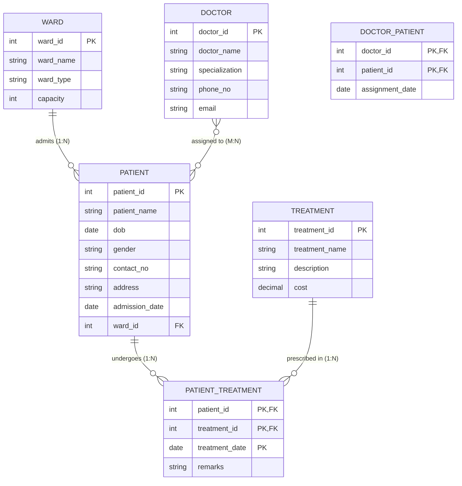

# Problem Statement 05: Hospital Management System

## Problem Description
A hospital wants to track patients, doctors, wards, and treatments. Each patient is admitted to a ward, and a ward can have multiple patients. Doctors can be assigned to multiple patients, and a patient can have multiple doctors. Each patient can undergo multiple treatments, and the hospital wants to store the treatment date for each treatment.

---

## Task 1: Identify Entities, Attributes, and Keys

### 1. Entity Sets

| Entity | Type | Description | Primary Key (PK) | Other Attributes |
|---|---|---|---|---|
| **Patient** | Strong Entity | Individuals admitted to the hospital receiving medical care | `patient_id` | `patient_name`, `dob`, `gender`, `contact_no`, `address`, `admission_date`, `ward_id` (FK) |
| **Doctor** | Strong Entity | Medical specialists and physicians working in the hospital | `doctor_id` | `doctor_name`, `specialization`, `phone_no`, `email` |
| **Ward** | Strong Entity | Hospital wards/rooms accommodating admitted patients | `ward_id` | `ward_name`, `ward_type`, `capacity` |
| **Treatment** | Strong Entity | Medical procedures, tests, or therapies provided | `treatment_id` | `treatment_name`, `description`, `cost` |

### 2. Attribute Classification

- **Patient**:
  - `patient_id`: Simple, single-valued, Key attribute (Primary Key).
  - `patient_name`: Simple, single-valued attribute.
  - `dob`: Simple, single-valued attribute (Date of Birth; age can be derived as `CURRENT_DATE - dob`).
  - `gender`: Simple, single-valued attribute (`M`, `F`, `Other`).
  - `contact_no`: Simple, single-valued attribute.
  - `address`: Composite attribute (Street, City, State, Zip) or simple string.
  - `admission_date`: Simple, single-valued attribute.
  - `ward_id`: Foreign Key referencing `Ward(ward_id)`.

- **Doctor**:
  - `doctor_id`: Simple, single-valued, Key attribute (Primary Key).
  - `doctor_name`: Simple, single-valued attribute.
  - `specialization`: Simple, single-valued attribute (e.g., Cardiology, Orthopedics, Neurology).
  - `phone_no`: Simple, single-valued attribute.
  - `email`: Simple, single-valued attribute.

- **Ward**:
  - `ward_id`: Simple, single-valued, Key attribute (Primary Key).
  - `ward_name`: Simple, single-valued attribute (e.g., ICU, General Ward, Pediatric Ward).
  - `ward_type`: Simple, single-valued attribute (e.g., General, Semi-Private, Private, Intensive Care).
  - `capacity`: Simple, single-valued numeric attribute (number of beds).

- **Treatment**:
  - `treatment_id`: Simple, single-valued, Key attribute (Primary Key).
  - `treatment_name`: Simple, single-valued attribute (e.g., MRI Scan, Chemotherapy, Appendectomy).
  - `description`: Simple, single-valued text attribute.
  - `cost`: Simple, single-valued numeric attribute (standard treatment cost).

---

## Task 2: Identify Relationships and Cardinalities

The problem description specifies three primary relationships:

### 1. `AdmittedTo` (Patient $\longleftrightarrow$ Ward)
- **Description**: Each patient is admitted to exactly one ward, while a ward can accommodate multiple patients.
- **Cardinality Ratio**: **Many-to-One ($N:1$)** from `Patient` to `Ward` (or $1:N$ from `Ward` to `Patient`).
- **Participation Constraints**:
  - `Patient`: **Total Participation** (every patient admitted in the hospital must be assigned to a ward).
  - `Ward`: **Partial Participation** (a ward can exist with 0 currently admitted patients).
- **Relational Representation**: Foreign key `ward_id` is placed inside the `Patient` relation.

### 2. `Assigned` (Doctor $\longleftrightarrow$ Patient)
- **Description**: Doctors can be assigned to multiple patients, and a patient can have multiple doctors attending them.
- **Cardinality Ratio**: **Many-to-Many ($M:N$)**.
- **Participation Constraints**:
  - `Doctor`: **Partial Participation** (a doctor might currently have 0 or multiple active patients).
  - `Patient`: **Total/Partial Participation** (a patient typically has at least one primary doctor assigned).
- **Descriptive Attributes**: `assignment_date` (date doctor was assigned to patient).
- **Relational Representation**: Decomposed into a separate junction table `Doctor_Patient` (`doctor_id`, `patient_id`).

### 3. `Undergoes` (Patient $\longleftrightarrow$ Treatment)
- **Description**: A patient can undergo multiple treatments, and a treatment can be administered to multiple patients over time.
- **Cardinality Ratio**: **Many-to-Many ($M:N$)**.
- **Participation Constraints**:
  - `Patient`: **Partial Participation** (a patient might not have undergone any treatment yet).
  - `Treatment`: **Partial Participation** (a treatment catalog entry exists before being administered to any patient).
- **Descriptive Attributes**: **`treatment_date`** (*explicitly required by problem statement*), `remarks`.
- **Relational Representation**: Decomposed into a separate junction table `Patient_Treatment` (`patient_id`, `treatment_id`, `treatment_date`).

### Summary Cardinality Matrix

| Relationship | Entity 1 | Entity 2 | Cardinality | Participation (E1) | Participation (E2) | Relationship Attribute(s) |
|---|---|---|---|---|---|---|
| **AdmittedTo** | Patient | Ward | $N:1$ | Total | Partial | — |
| **Assigned** | Doctor | Patient | $M:N$ | Partial | Total / Partial | `assignment_date` |
| **Undergoes** | Patient | Treatment | $M:N$ | Partial | Partial | `treatment_date`, `remarks` |

---

## Task 3: Entity-Relationship (ER) Diagram

### Mermaid ER Diagram



### Text / Chen-Style Representation

```text
    +-----------+                 ( 1 ) +------------+ ( N )                 +-----------+
    |   WARD    |<----------------------| AdmittedTo |---------------------->|  PATIENT  |
    +-----------+                       +------------+                       +-----------+
      |  PK: ward_id                                                           |  PK: patient_id
      |  ward_name                                                             |  patient_name
      |  ward_type                                                             |  dob, gender
      |  capacity                                                              |  contact_no, address
                                                                               |  admission_date
                                                                               |  FK: ward_id
    +-----------+                       +------------+                         |
    |  DOCTOR   |-----------------------|  Assigned  |-------------------------+
    +-----------+ ( M )                 +------------+ ( N )                   |
      |  PK: doctor_id                                                         |
      |  doctor_name                                                           |
      |  specialization                                                        |
      |  phone_no, email                                                       |
                                                                               |
    +-----------+                       +------------+                         |
    | TREATMENT |-----------------------|  Undergoes |-------------------------+
    +-----------+ ( N )                 +------------+ ( M )
         PK: treatment_id                      |
         treatment_name                  [treatment_date]
         description                     [remarks]
         cost
```

---

## Task 4: Convert ER Diagram into Relational Tables

Applying the standard ER-to-Relational Mapping rules:

1. **Mapping of Strong Entities**: Create a relation for each entity with its simple attributes.
2. **Mapping of 1:N Binary Relationship (`AdmittedTo`)**: Include the primary key of the "1" side (`Ward`) as a foreign key in the "N" side (`Patient`).
3. **Mapping of M:N Binary Relationships (`Assigned`, `Undergoes`)**: Create a new relation (cross-reference table) containing the primary keys of both participating entities as foreign keys. Together they form the composite primary key. Any relationship attributes become columns of this relation.

### Relational Schema

1. **`Ward`** (<u>`ward_id`</u>, `ward_name`, `ward_type`, `capacity`)
2. **`Patient`** (<u>`patient_id`</u>, `patient_name`, `dob`, `gender`, `contact_no`, `address`, `admission_date`, `ward_id`*)  
   *(Foreign Key: `ward_id` references `Ward(ward_id)`)*
3. **`Doctor`** (<u>`doctor_id`</u>, `doctor_name`, `specialization`, `phone_no`, `email`)
4. **`Treatment`** (<u>`treatment_id`</u>, `treatment_name`, `description`, `cost`)
5. **`Doctor_Patient`** (<u>`doctor_id`*</u>, <u>`patient_id`*</u>, `assignment_date`)  
   *(Foreign Keys: `doctor_id` references `Doctor(doctor_id)`, `patient_id` references `Patient(patient_id)`)*
6. **`Patient_Treatment`** (<u>`patient_id`*</u>, <u>`treatment_id`*</u>, <u>`treatment_date`</u>, `remarks`)  
   *(Foreign Keys: `patient_id` references `Patient(patient_id)`, `treatment_id` references `Treatment(treatment_id)`)*

---

## Task 5: Normalize the Relational Tables up to 3NF

### Functional Dependencies (FDs)
From the business rules of the hospital:
1. `ward_id` $\rightarrow$ `ward_name`, `ward_type`, `capacity`
2. `doctor_id` $\rightarrow$ `doctor_name`, `specialization`, `phone_no`, `email`
3. `treatment_id` $\rightarrow$ `treatment_name`, `description`, `cost`
4. `patient_id` $\rightarrow$ `patient_name`, `dob`, `gender`, `contact_no`, `address`, `admission_date`, `ward_id`
5. `(doctor_id, patient_id)` $\rightarrow$ `assignment_date`
6. `(patient_id, treatment_id, treatment_date)` $\rightarrow$ `remarks`

---

### Step-by-Step Normalization

#### 1. Unnormalized Form (UNF)
In an unnormalized flat record, a single patient row holds multiple doctors and multiple treatments as repeating groups:
```text
Hospital_Record (
    patient_id, patient_name, dob, gender, contact_no, address, admission_date,
    ward_id, ward_name, ward_type, capacity,
    { doctor_id, doctor_name, specialization, phone_no, email },
    { treatment_id, treatment_name, description, cost, treatment_date, remarks }
)
```
- **Anomalies in UNF**: High data redundancy, insertion anomaly (cannot add a ward/doctor without a patient), update anomaly (inconsistent doctor names across rows), deletion anomaly (discharging a patient deletes ward or doctor records).

---

#### 2. First Normal Form (1NF)
> **Definition**: A relation is in 1NF if and only if all attribute domains contain only atomic (indivisible) values and there are no repeating groups.

- **Action**: Flatten the repeating groups so each cell holds a single atomic value.
- The flattened relation has a composite primary key: `(patient_id, doctor_id, treatment_id, treatment_date)`:
```text
Flat_Hospital_1NF (
    patient_id, doctor_id, treatment_id, treatment_date,
    patient_name, dob, gender, contact_no, address, admission_date,
    ward_id, ward_name, ward_type, capacity,
    doctor_name, specialization, phone_no, email,
    treatment_name, description, cost, remarks
)
```
- **Problem**: In this relation, many non-prime attributes depend only on a part of the composite primary key.

---

#### 3. Second Normal Form (2NF)
> **Definition**: A relation is in 2NF if and only if it is in 1NF and every non-prime attribute is **fully functionally dependent** on the whole candidate key (i.e., **no partial dependencies**).

- **Identified Partial Dependencies**:
  - `patient_id` $\rightarrow$ `patient_name`, `dob`, `gender`, `contact_no`, `address`, `admission_date`, `ward_id`, `ward_name`, `ward_type`, `capacity`  
    *(Depends only on part of key `patient_id`)*
  - `doctor_id` $\rightarrow$ `doctor_name`, `specialization`, `phone_no`, `email`  
    *(Depends only on part of key `doctor_id`)*
  - `treatment_id` $\rightarrow$ `treatment_name`, `description`, `cost`  
    *(Depends only on part of key `treatment_id`)*
  - `(doctor_id, patient_id)` $\rightarrow$ `assignment_date`
  - `(patient_id, treatment_id, treatment_date)` $\rightarrow$ `remarks`

- **Decomposition to achieve 2NF**:
  1. `Patient_Ward_Info` (<u>`patient_id`</u>, `patient_name`, `dob`, `gender`, `contact_no`, `address`, `admission_date`, `ward_id`, `ward_name`, `ward_type`, `capacity`)
  2. `Doctor` (<u>`doctor_id`</u>, `doctor_name`, `specialization`, `phone_no`, `email`)
  3. `Treatment` (<u>`treatment_id`</u>, `treatment_name`, `description`, `cost`)
  4. `Doctor_Patient` (<u>`doctor_id`</u>, <u>`patient_id`</u>, `assignment_date`)
  5. `Patient_Treatment` (<u>`patient_id`</u>, <u>`treatment_id`</u>, <u>`treatment_date`</u>, `remarks`)

All relations are now free of partial dependencies and therefore in **2NF**.

---

#### 4. Third Normal Form (3NF)
> **Definition**: A relation is in 3NF if and only if it is in 2NF and **no non-prime attribute is transitively dependent on any candidate key** (i.e., for every non-trivial functional dependency $X \rightarrow Y$, $X$ is a superkey or $Y$ is a prime attribute).

- **Inspecting Transitive Dependencies**:
  - In `Patient_Ward_Info`:
    - Primary key is `patient_id`.
    - We have `patient_id` $\rightarrow$ `ward_id`.
    - We also have `ward_id` $\rightarrow$ `ward_name`, `ward_type`, `capacity`.
    - Therefore, `patient_id` $\rightarrow$ `ward_name` is a **transitive dependency** via `ward_id`!
    - Neither `ward_id` is a superkey of `Patient_Ward_Info`, nor are `ward_name`, `ward_type`, `capacity` prime attributes.

- **Decomposition to achieve 3NF**:
  Decompose `Patient_Ward_Info` into:
  1. **`Ward`**:
     - Columns: (<u>`ward_id`</u>, `ward_name`, `ward_type`, `capacity`)
     - FD: `ward_id` $\rightarrow$ `ward_name`, `ward_type`, `capacity`.
     - `ward_id` is the superkey $\implies$ **In 3NF**.
  2. **`Patient`**:
     - Columns: (<u>`patient_id`</u>, `patient_name`, `dob`, `gender`, `contact_no`, `address`, `admission_date`, `ward_id`*)
     - FD: `patient_id` $\rightarrow$ `patient_name`, `dob`, `gender`, `contact_no`, `address`, `admission_date`, `ward_id`.
     - `patient_id` is the superkey $\implies$ **In 3NF**.

- **Verifying all other tables**:
  - **`Doctor`**: Only non-trivial FDs have LHS = `doctor_id` (candidate key). $\implies$ **In 3NF**.
  - **`Treatment`**: Only non-trivial FDs have LHS = `treatment_id` (candidate key). $\implies$ **In 3NF**.
  - **`Doctor_Patient`**: Only non-trivial FD is `(doctor_id, patient_id)` $\rightarrow$ `assignment_date`. LHS is candidate key. $\implies$ **In 3NF**.
  - **`Patient_Treatment`**: Only non-trivial FD is `(patient_id, treatment_id, treatment_date)` $\rightarrow$ `remarks`. LHS is candidate key. $\implies$ **In 3NF**.

---

### Final 3NF Normalized Schema Summary

| Table Name | Primary Key | Foreign Keys | Non-Key Attributes | Normal Form |
|---|---|---|---|---|
| **Ward** | `ward_id` | None | `ward_name`, `ward_type`, `capacity` | **3NF / BCNF** |
| **Patient** | `patient_id` | `ward_id` $\rightarrow$ `Ward(ward_id)` | `patient_name`, `dob`, `gender`, `contact_no`, `address`, `admission_date` | **3NF / BCNF** |
| **Doctor** | `doctor_id` | None | `doctor_name`, `specialization`, `phone_no`, `email` | **3NF / BCNF** |
| **Treatment** | `treatment_id` | None | `treatment_name`, `description`, `cost` | **3NF / BCNF** |
| **Doctor_Patient** | `(doctor_id, patient_id)` | `doctor_id` $\rightarrow$ `Doctor`, `patient_id` $\rightarrow$ `Patient` | `assignment_date` | **3NF / BCNF** |
| **Patient_Treatment** | `(patient_id, treatment_id, treatment_date)` | `patient_id` $\rightarrow$ `Patient`, `treatment_id` $\rightarrow$ `Treatment` | `remarks` | **3NF / BCNF** |

**Properties of this decomposition:**
1. **Lossless Join Decomposition**: Guaranteed because at each decomposition step, the intersection of schemas forms a candidate key of at least one sub-relation.
2. **Dependency Preservation**: All identified functional dependencies are preserved within individual decomposed relations.

