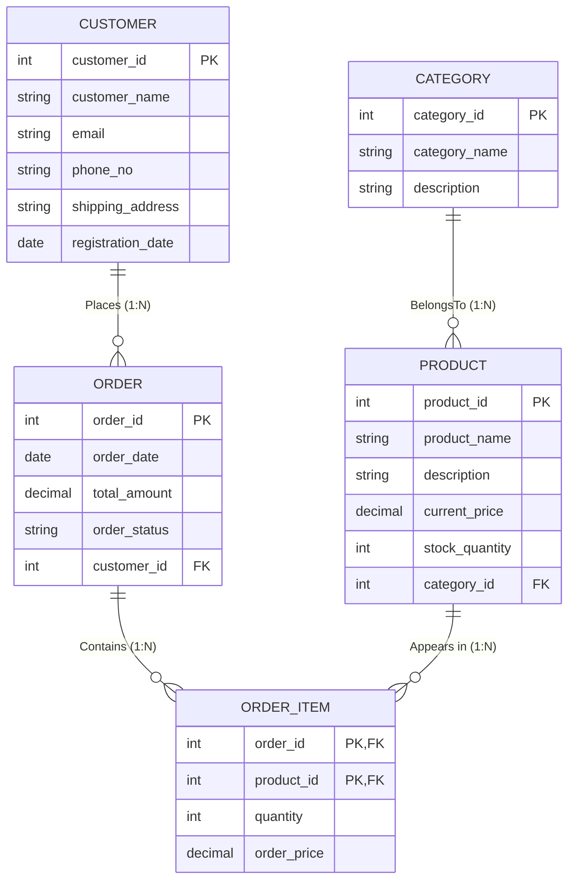

# Problem Statement 06: Online Shopping System

## Problem Description
An online shopping platform wants to manage customers, products, orders, and product categories. Each customer can place multiple orders. Each order can contain multiple products, and each product can appear in multiple orders. Each product belongs to a category. For each product in an order, the system wants to store the quantity and price at the time of order.

---

## Task 1: Identify Entities, Attributes, and Keys

### 1. Entity Sets

| Entity | Type | Description | Primary Key (PK) | Other Attributes |
|---|---|---|---|---|
| **Customer** | Strong Entity | Users registered on the platform who purchase products | `customer_id` | `customer_name`, `email`, `phone_no`, `shipping_address`, `registration_date` |
| **Category** | Strong Entity | Product classifications/departments (e.g., Electronics, Fashion) | `category_id` | `category_name`, `description` |
| **Product** | Strong Entity | Items available in the store catalog for purchase | `product_id` | `product_name`, `description`, `current_price`, `stock_quantity`, `category_id` (FK) |
| **Order** | Strong Entity | Purchase transactions initiated by customers | `order_id` | `order_date`, `total_amount`, `order_status`, `customer_id` (FK) |

### 2. Attribute Classification

- **Customer**:
  - `customer_id`: Simple, single-valued, Key attribute (Primary Key).
  - `customer_name`: Simple, single-valued attribute.
  - `email`: Simple, single-valued, Unique attribute.
  - `phone_no`: Simple, single-valued attribute.
  - `shipping_address`: Composite attribute (Street, City, State, Pin) or simple string.
  - `registration_date`: Simple, single-valued date attribute.

- **Category**:
  - `category_id`: Simple, single-valued, Key attribute (Primary Key).
  - `category_name`: Simple, single-valued, Unique attribute (e.g., Electronics, Footwear, Books).
  - `description`: Simple, single-valued text attribute.

- **Product**:
  - `product_id`: Simple, single-valued, Key attribute (Primary Key).
  - `product_name`: Simple, single-valued attribute.
  - `description`: Simple, single-valued text attribute.
  - `current_price`: Simple, single-valued numeric attribute (current catalog retail price).
  - `stock_quantity`: Simple, single-valued integer attribute (available units in inventory).
  - `category_id`: Foreign Key referencing `Category(category_id)`.

- **Order**:
  - `order_id`: Simple, single-valued, Key attribute (Primary Key).
  - `order_date`: Simple, single-valued timestamp/date attribute.
  - `total_amount`: Derived or stored numeric attribute.
  - `order_status`: Simple, single-valued attribute (e.g., 'Placed', 'Processing', 'Shipped', 'Delivered', 'Cancelled').
  - `customer_id`: Foreign Key referencing `Customer(customer_id)`.

---

## Task 2: Identify Relationships and Cardinalities

The problem description specifies three primary relationships:

### 1. `Places` (Customer $\longleftrightarrow$ Order)
- **Description**: *"Each customer can place multiple orders."* (An order belongs to exactly one customer).
- **Cardinality Ratio**: **One-to-Many ($1:N$)** from `Customer` to `Order` (or $N:1$ from `Order` to `Customer`).
- **Participation Constraints**:
  - `Customer`: **Partial Participation** (a registered user may not have placed any order yet).
  - `Order`: **Total Participation** (every order must be placed by a valid customer).
- **Relational Representation**: Foreign key `customer_id` is embedded inside the `Order` table.

### 2. `BelongsTo` (Product $\longleftrightarrow$ Category)
- **Description**: *"Each product belongs to a category."* (A category can contain multiple products).
- **Cardinality Ratio**: **Many-to-One ($N:1$)** from `Product` to `Category` (or $1:N$ from `Category` to `Product`).
- **Participation Constraints**:
  - `Product`: **Total Participation** (every product catalog item must be assigned to a category).
  - `Category`: **Partial Participation** (a category can exist before products are added to it).
- **Relational Representation**: Foreign key `category_id` is embedded inside the `Product` table.

### 3. `Contains` (Order $\longleftrightarrow$ Product)
- **Description**: *"Each order can contain multiple products, and each product can appear in multiple orders. For each product in an order, the system wants to store the quantity and price at the time of order."*
- **Cardinality Ratio**: **Many-to-Many ($M:N$)**.
- **Descriptive Attributes**:
  - **`quantity`**: Number of units of the product ordered.
  - **`order_price`** / **`price_at_order`**: Snapshot price at the exact moment of purchase. This is critical in e-commerce because catalog prices change, but past receipts must remain historically accurate.
- **Participation Constraints**:
  - `Order`: **Total Participation** (an order must contain at least one product item).
  - `Product`: **Partial Participation** (a new product might not have been purchased in any order yet).
- **Relational Representation**: Decomposed into a separate junction table `Order_Item` (`order_id`, `product_id`, `quantity`, `order_price`).

### Summary Cardinality Matrix

| Relationship | Entity 1 | Entity 2 | Cardinality | Participation (E1) | Participation (E2) | Relationship Attribute(s) |
|---|---|---|---|---|---|---|
| **Places** | Customer | Order | $1:N$ | Partial | Total | — |
| **BelongsTo** | Product | Category | $N:1$ | Total | Partial | — |
| **Contains** | Order | Product | $M:N$ | Total | Partial | **`quantity`**, **`order_price`** |

---

## Task 3: Entity-Relationship (ER) Diagram

### Mermaid ER Diagram



### Text / Chen-Style Representation

```text
    +--------------+              ( 1 ) +----------+ ( N )              +--------------+
    |   CUSTOMER   |<-------------------|  Places  |------------------->|    ORDER     |
    +--------------+                    +----------+                    +--------------+
      |  PK: customer_id                                                  |  PK: order_id
      |  customer_name                                                    |  order_date
      |  email, phone_no                                                  |  total_amount, order_status
      |  shipping_address                                                 |  FK: customer_id
      |  registration_date                                                |
                                                                          |
                                        +----------+ ( 1 )                |
                                        | Contains |<---------------------+
                                        +----------+
                                              | ( N )
                                         [quantity]
                                         [order_price]
                                              v
    +--------------+              ( 1 ) +----------+ ( N )              +--------------+
    |   CATEGORY   |<-------------------|BelongsTo |------------------->|   PRODUCT    |
    +--------------+                    +----------+                    +--------------+
         PK: category_id                                                     PK: product_id
         category_name                                                       product_name
         description                                                         description
                                                                             current_price
                                                                             stock_quantity
                                                                             FK: category_id
```

---

## Task 4: Convert ER Diagram into Relational Tables

Applying the standard ER-to-Relational Mapping rules:

1. **Mapping of Regular Entities**:
   - `Customer` and `Category` map directly to tables with their simple attributes.
2. **Mapping of 1:N Relationships (`Places`, `BelongsTo`)**:
   - For `Places` (1:N from Customer to Order): Embed `customer_id` as a foreign key in `Order`.
   - For `BelongsTo` (1:N from Category to Product): Embed `category_id` as a foreign key in `Product`.
3. **Mapping of M:N Relationship (`Contains`)**:
   - Create a junction table `Order_Item` (or `Order_Product`).
   - Primary key is the composite key: `(order_id, product_id)`.
   - Embed descriptive attributes: `quantity` and `order_price`.

### Relational Schema

1. **`Category`** (<u>`category_id`</u>, `category_name`, `description`)
2. **`Product`** (<u>`product_id`</u>, `product_name`, `description`, `current_price`, `stock_quantity`, `category_id`*)  
   *(Foreign Key: `category_id` references `Category(category_id)`)*
3. **`Customer`** (<u>`customer_id`</u>, `customer_name`, `email`, `phone_no`, `shipping_address`, `registration_date`)
4. **`Orders`** (<u>`order_id`</u>, `order_date`, `total_amount`, `order_status`, `customer_id`*)  
   *(Foreign Key: `customer_id` references `Customer(customer_id)`)*
5. **`Order_Item`** (<u>`order_id`*</u>, <u>`product_id`*</u>, `quantity`, `order_price`)  
   *(Foreign Keys: `order_id` references `Orders(order_id)`, `product_id` references `Product(product_id)`)*

---

## Task 5: Normalization up to 3NF

### Functional Dependencies (FDs)
1. `category_id` $\rightarrow$ `category_name`, `description`
2. `product_id` $\rightarrow$ `product_name`, `description`, `current_price`, `stock_quantity`, `category_id`
3. `customer_id` $\rightarrow$ `customer_name`, `email`, `phone_no`, `shipping_address`, `registration_date`
4. `order_id` $\rightarrow$ `order_date`, `total_amount`, `order_status`, `customer_id`
5. `(order_id, product_id)` $\rightarrow$ `quantity`, `order_price`

---

### Step-by-Step Normalization Process

#### 1. Unnormalized Form (UNF)
In an unnormalized flat purchase order sheet, each row stores repeating groups of products, categories, and customer information:
```text
Shopping_Record_UNF (
    order_id, order_date, total_amount, order_status,
    customer_id, customer_name, email, phone_no, shipping_address, registration_date,
    { product_id, product_name, description, current_price, stock_quantity,
      category_id, category_name, category_description,
      quantity, order_price }
)
```
- **Anomalies in UNF**: Extensive data redundancy, insertion anomaly (cannot create a product or category without placing an order), deletion anomaly (cancelling or deleting an order deletes product or customer information).

---

#### 2. First Normal Form (1NF)
> **Definition**: A relation is in 1NF if and only if all attribute values are atomic and there are no repeating groups.

- **Action**: Flatten repeating groups so each record contains only atomic values.
- Primary Key of flattened relation: `(order_id, product_id)`:
```text
Flat_Shopping_1NF (
    order_id, product_id,
    order_date, total_amount, order_status,
    customer_id, customer_name, email, phone_no, shipping_address, registration_date,
    product_name, product_description, current_price, stock_quantity,
    category_id, category_name, category_description,
    quantity, order_price
)
```
- **Problem**: In this relation, many non-prime attributes depend only on a part of the composite primary key (violates 2NF).

---

#### 3. Second Normal Form (2NF)
> **Definition**: A relation is in 2NF if and only if it is in 1NF and no non-prime attribute is partially dependent on any candidate key.

- **Identified Partial Dependencies**:
  - `order_id` $\rightarrow$ `order_date`, `total_amount`, `order_status`, `customer_id`, `customer_name`, `email`, `phone_no`, `shipping_address`, `registration_date` *(Depends only on `order_id`, a proper subset of candidate key)*
  - `product_id` $\rightarrow$ `product_name`, `product_description`, `current_price`, `stock_quantity`, `category_id`, `category_name`, `category_description` *(Depends only on `product_id`, a proper subset of candidate key)*
  - `(order_id, product_id)` $\rightarrow$ `quantity`, `order_price` *(Fully functionally dependent on the entire primary key)*

- **Decomposition to achieve 2NF**:
  1. `Order_Customer_Info` (<u>`order_id`</u>, `order_date`, `total_amount`, `order_status`, `customer_id`, `customer_name`, `email`, `phone_no`, `shipping_address`, `registration_date`)
  2. `Product_Category_Info` (<u>`product_id`</u>, `product_name`, `product_description`, `current_price`, `stock_quantity`, `category_id`, `category_name`, `category_description`)
  3. `Order_Item` (<u>`order_id`</u>, <u>`product_id`</u>, `quantity`, `order_price`)

All partial dependencies have been eliminated. All three tables are in **2NF**.

---

#### 4. Third Normal Form (3NF)
> **Definition**: A relation is in 3NF if and only if it is in 2NF and no non-prime attribute is transitively dependent on any candidate key.

- **Inspecting Transitive Dependencies**:
  1. In `Order_Customer_Info`:
     - Primary key is `order_id`.
     - We have `order_id` $\rightarrow$ `customer_id`.
     - We also have `customer_id` $\rightarrow$ `customer_name`, `email`, `phone_no`, `shipping_address`, `registration_date`.
     - This is a **transitive dependency**: $\text{order\_id} \rightarrow \text{customer\_id} \rightarrow \text{customer details}$.
     - `customer_id` is not a superkey in `Order_Customer_Info`.
  2. In `Product_Category_Info`:
     - Primary key is `product_id`.
     - We have `product_id` $\rightarrow$ `category_id`.
     - We also have `category_id` $\rightarrow$ `category_name`, `category_description`.
     - This is a **transitive dependency**: $\text{product\_id} \rightarrow \text{category\_id} \rightarrow \text{category details}$.
     - `category_id` is not a superkey in `Product_Category_Info`.

- **Decomposition to achieve 3NF**:
  1. Decompose `Order_Customer_Info` into:
     - **`Customer`**: (<u>`customer_id`</u>, `customer_name`, `email`, `phone_no`, `shipping_address`, `registration_date`)  
       *FD: `customer_id` is superkey $\implies$ 3NF.*
     - **`Orders`**: (<u>`order_id`</u>, `order_date`, `total_amount`, `order_status`, `customer_id`*)  
       *FD: `order_id` is superkey $\implies$ 3NF.*
  2. Decompose `Product_Category_Info` into:
     - **`Category`**: (<u>`category_id`</u>, `category_name`, `description`)  
       *FD: `category_id` is superkey $\implies$ 3NF.*
     - **`Product`**: (<u>`product_id`</u>, `product_name`, `description`, `current_price`, `stock_quantity`, `category_id`*)  
       *FD: `product_id` is superkey $\implies$ 3NF.*
  3. **`Order_Item`**: (<u>`order_id`</u>, <u>`product_id`</u>, `quantity`, `order_price`)  
     *Candidate key is `(order_id, product_id)`. Non-key attributes depend directly on key $\implies$ 3NF.*

---

### Final 3NF Normalized Schema Summary

| Table Name | Primary Key | Foreign Keys | Non-Key Attributes | Normal Form |
|---|---|---|---|---|
| **Category** | `category_id` | None | `category_name`, `description` | **3NF / BCNF** |
| **Product** | `product_id` | `category_id` $\rightarrow$ `Category(category_id)` | `product_name`, `description`, `current_price`, `stock_quantity` | **3NF / BCNF** |
| **Customer** | `customer_id` | None | `customer_name`, `email`, `phone_no`, `shipping_address`, `registration_date` | **3NF / BCNF** |
| **Orders** | `order_id` | `customer_id` $\rightarrow$ `Customer(customer_id)` | `order_date`, `total_amount`, `order_status` | **3NF / BCNF** |
| **Order_Item** | `(order_id, product_id)` | `order_id` $\rightarrow$ `Orders`, `product_id` $\rightarrow$ `Product` | `quantity`, `order_price` | **3NF / BCNF** |

**Guarantees:**
1. **Lossless Join Decomposition**: Preserved across all steps.
2. **Dependency Preservation**: All functional dependencies are preserved within their respective relations.
3. **No Redundancy**: Price changes to products in catalog do not corrupt historic receipts.

